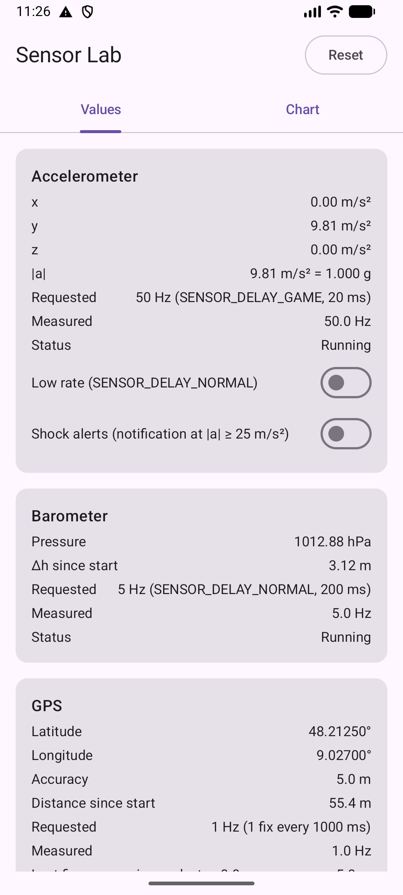
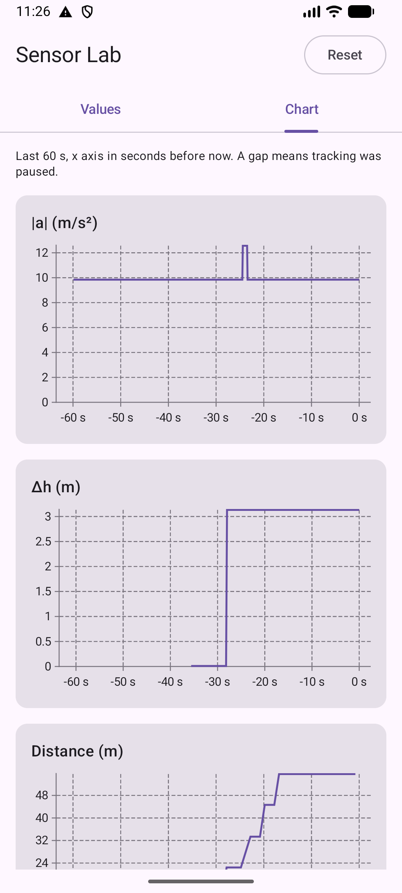
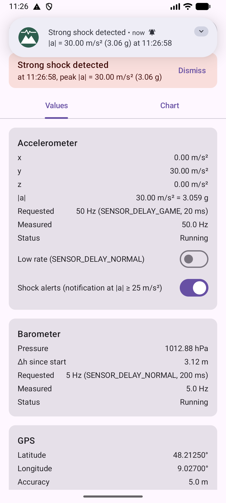

# Screenshots

Taken on the emulator (see the development environment) with injected values: after **Reset**, the phone at rest with one bump of about 12.5 m/s², the pressure of one floor higher and a walk of 5 GPS steps north; then one shock of 30 m/s² with **Shock alerts** on.

::: shots

:::
